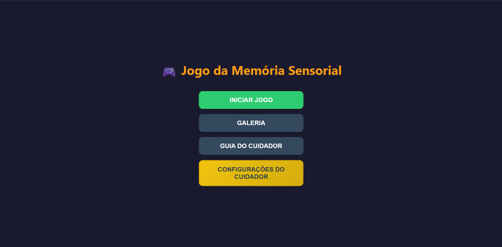
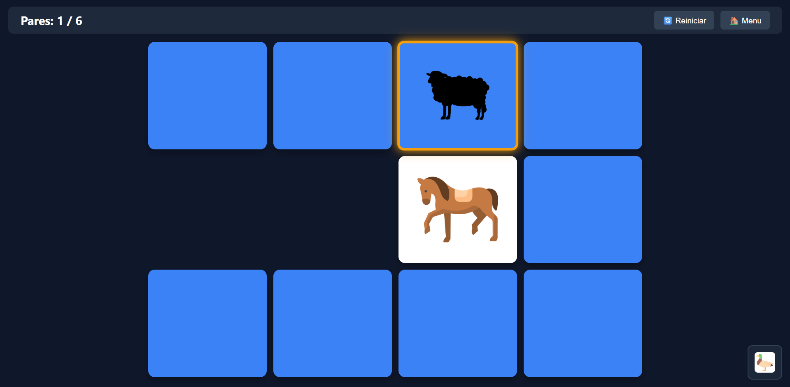
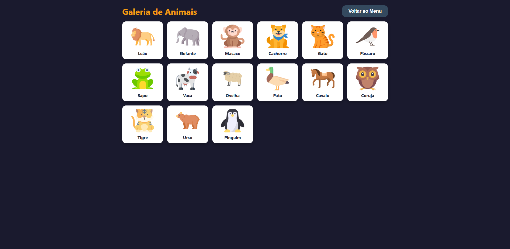
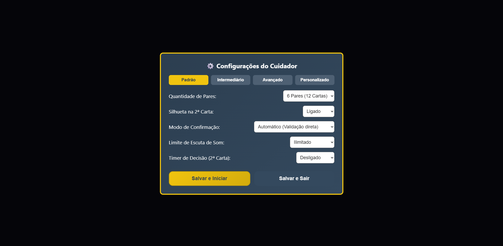

# Jogo da Memória Multissensorial

Projeto educacional interativo voltado ao estímulo visual e auditivo, desenvolvido para uso em telas touchscreen (como TVs e tablets) em contextos de mediação pedagógica, para os alunos da APAE.

> **Jogar online:** [Acesse o Jogo da Memória Multissensorial](https://lucassantos-arch123.github.io/Jogo-da-Memoria-Para-APAE/)

## Objetivo e Finalidade

* **Estímulo multissensorial:** Associa imagens de animais a seus respectivos sons para apoiar a percepção visual, auditiva e a memória.
* **Mediação do cuidador:** Permite ajustar a quantidade de pares (4, 6 ou 8), ativar ou desativar silhueta na segunda carta, alternar entre confirmação automática e manual, limitar repetições de som e definir tempo de decisão.
* **Exploração livre:** Conta com uma **Galeria** com os 15 animais para visualização e reprodução direta dos sons.

## Capturas de Tela

### Menu Principal

Acesso direto para iniciar a partida, abrir a galeria de animais, consultar o guia de mediação ou ajustar as configurações do cuidador.

### Tela do Jogo

Tabuleiro interativo com cartas, contador de pares, controles de reinício e menu, área inferior de coleção dos pares encontrados e barra de confirmação manual quando ativada.

### Galeria de Animais

Grade com os 15 animais em imagens reais para exploração livre e reprodução do som correspondente ao tocar em cada cartão.

### Guia do Cuidador

Orientações de mediação pedagógica para uso em telas touchscreen, explicando o comportamento da 1ª e da 2ª carta e a adaptação ao aluno.

### Configurações do Cuidador

Seleção de níveis predefinidos ou personalizados, quantidade de pares, silhueta na 2ª carta, confirmação automática ou manual, limite de escuta do som e timer de decisão.

## Estrutura do Projeto

* `index.html` — Estrutura das telas (menu principal, galeria, jogo) e modais (guia, configurações, confirmação e vitória).
* `css/style.css` — Layout, grade do tabuleiro e da galeria, estados das cartas (virada, silhueta, selecionada) e área de coleção.
* `js/dados.js` — Lista dos 15 animais (`animaisDB`) com caminhos de imagem e áudio.
* `js/game.js` — Controle de navegação, configurações, reprodução e interrupção de áudio, mecânica de pares, coleção e montagem da galeria.
* `assets/animals/` — Imagens dos animais.
* `assets/sounds/` — Áudios dos animais e sons do sistema.

## Como Executar

1. Mantenha a estrutura de pastas e arquivos intacta.
2. Abra o `index.html` em um navegador moderno (de preferência via servidor local, como Live Server, para evitar bloqueios de reprodução de mídia em alguns navegadores).

## NOTA: Desenvolvimento com Inteligência Artificial

Este projeto foi desenvolvido com Inteligência Artificial (Gemini), utilizada para estruturação e refatoração do código, corrigir problemas de renderização e estado, organizar os estilos e implementar funcionalidades como a galeria e os controles de mediação. A revisão, os testes práticos e a adequação pedagógica ao público-alvo foram conduzidos no desenvolvimento do projeto.
